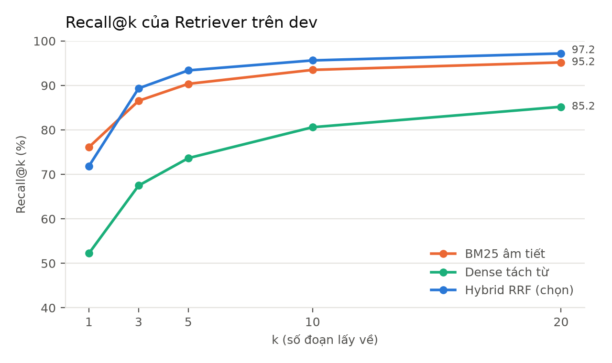
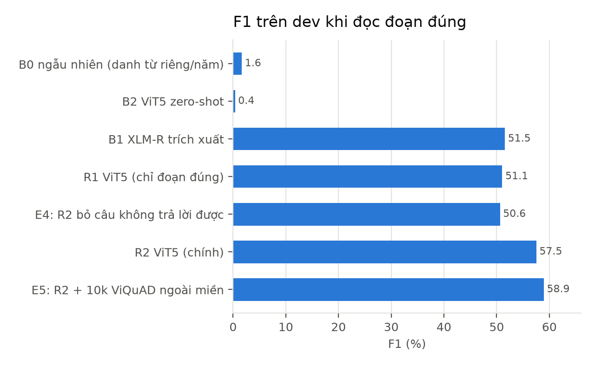
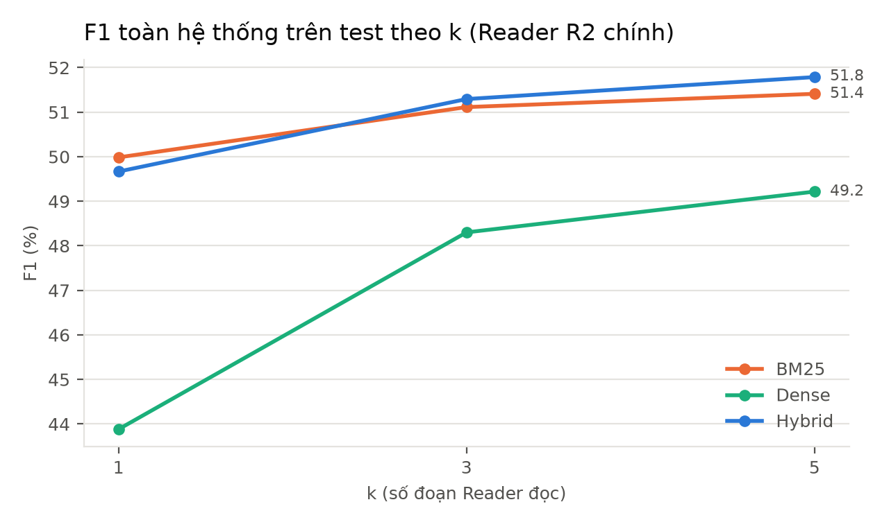
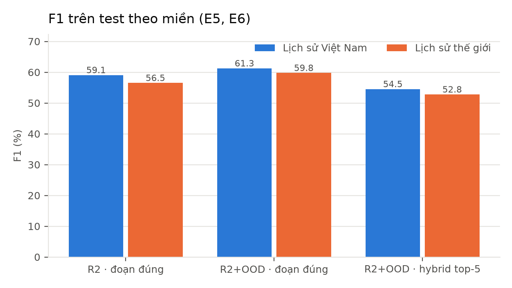
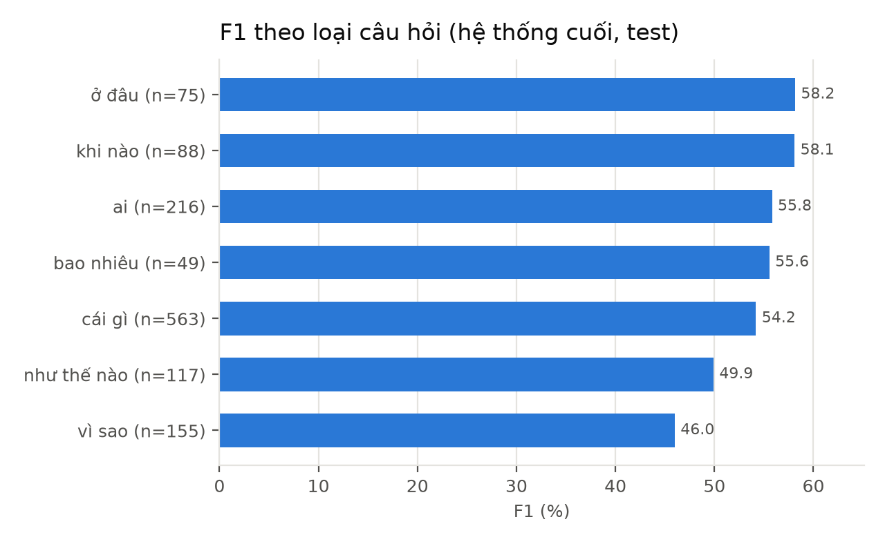
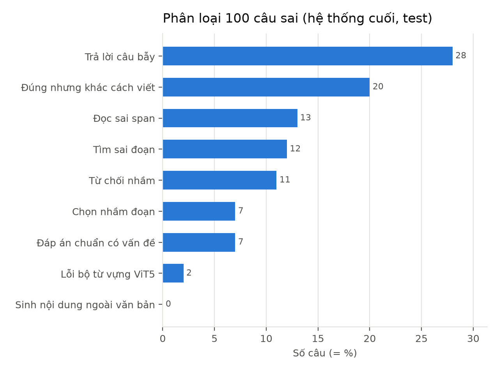

# Kết quả tổng hợp

Sinh bởi `scripts/make_results.py` từ các file `reports/*.json`. Đơn vị: %. Giải mã **greedy** (mặc định; biến thể có ngưỡng từ chối xem `reports/gd5_results.md`). Dev dùng để chọn cấu hình, **test chỉ chạy một lần** (GĐ5). Chi tiết từng giai đoạn: `retriever_dev.md`, `baselines_dev.md`, `reader_vit5_dev.md`, `gd5_results.md`, `gd5_summary.md`, `gd6_summary.md`, `latency.md`.

## 1. Dữ liệu

UIT-ViQuAD 2.0, giữ 38 bài lịch sử (9 Việt Nam, 29 thế giới), **chia theo bài** (không rò rỉ đoạn văn giữa các tập). Kho tri thức 1.862 đoạn. Bảng đầy đủ: `data_stats.md`.

| Tập | Bài | Đoạn | Trả lời được | Không trả lời được | Tổng |
|---|---|---|---|---|---|
| train | 23 | 1.491 | 6.347 | 3.047 | 9.394 |
| dev | 8 | 179 | 892 | 437 | 1.329 |
| test | 7 | 192 | 887 | 399 | 1.286 |

## 2. Retriever (dev, 892 câu trả lời được)

| Cấu hình | R@1 | R@3 | R@5 | R@10 | R@20 | MRR |
|---|---|---|---|---|---|---|
| BM25 · âm tiết | 76.1 | 86.5 | 90.4 | 93.5 | 95.2 | 82.4 |
| BM25 · tách từ | 74.8 | 85.1 | 88.7 | 91.5 | 93.5 | 80.9 |
| Dense · văn bản thô | 49.4 | 63.7 | 71.0 | 76.9 | 81.6 | 58.8 |
| Dense · tách từ | 52.2 | 67.5 | 73.7 | 80.6 | 85.2 | 61.7 |
| Hybrid · BM25 âm tiết + Dense tách từ (k=60, w=1) | 67.3 | 82.1 | 86.2 | 92.3 | 96.7 | 76.3 |
| Hybrid · BM25 tách từ + Dense tách từ (k=60, w=1) | 67.4 | 80.9 | 84.8 | 90.7 | 95.2 | 75.5 |
| **Hybrid · BM25 âm tiết + Dense tách từ (k=5, w=0.7) (chọn)** | 71.9 | 89.3 | 93.4 | 95.6 | 97.2 | 81.3 |

Trên test (đoạn đúng nằm trong k đoạn đã đọc, câu trả lời được):

| Retriever | k=1 | k=3 | k=5 |
|---|---|---|---|
| bm25 | 67.8 | 80.8 | 86.1 |
| dense | 46.6 | 65.1 | 71.8 |
| hybrid | 67.6 | 86.7 | 90.2 |

## 3. Reader đọc đoạn đúng (E1, E4, E5)

| Hệ thống | Tập | EM | F1 | HasAns-F1 | NoAns-acc |
|---|---|---|---|---|---|
| B0 ngẫu nhiên (danh từ riêng/năm) | dev | 0.1 | 1.6 | 2.4 | 0.0 |
| B2 ViT5 zero-shot | dev | 0.0 | 0.4 | 0.6 | 0.0 |
| B1 XLM-R trích xuất | dev | 37.4 | 51.5 | 61.7 | 30.9 |
| R1 ViT5 (chỉ đoạn đúng) | dev | 37.4 | 51.1 | 57.3 | 38.2 |
| E4: R2 bỏ câu không trả lời được | dev | 36.0 | 50.6 | 62.2 | 27.0 |
| R2 ViT5 (chính) | dev | 44.1 | 57.5 | 59.2 | 54.0 |
| E5: R2 + 10k ViQuAD ngoài miền | dev | 44.2 | 58.9 | 63.4 | 49.9 |
| E4: R2 bỏ câu không trả lời được | test | 33.8 | 51.2 | 60.9 | 29.6 |
| R2 ViT5 (chính) | test | 40.4 | 57.4 | 58.3 | 55.4 |
| E5: R2 + 10k ViQuAD ngoài miền | test | 44.6 | 60.3 | 60.1 | 60.7 |

B1, R1 chỉ có checkpoint trên Drive nên chưa chấm test. R1 = ViT5 train với đoạn đúng (9.394 mẫu, 32,4% không trả lời được); R2 = R1 + mỗi câu trả lời được thêm 1 đoạn nhiễu từ retriever với nhãn "không có câu trả lời" (15.741 mẫu).

## 4. Toàn hệ thống trên test (E2, E3)

F1 của Reader R2 chính theo retriever và số đoạn k:

| Retriever | k=1 | k=3 | k=5 |
|---|---|---|---|
| bm25 | 50.0 | 51.1 | 51.4 |
| dense | 43.9 | 48.3 | 49.2 |
| hybrid | 49.7 | 51.3 | 51.8 |
| hybrid + Reader E5 (r2ood) | 51.9 | 54.0 | 53.4 |

**Hệ thống cuối (r2ood + hybrid top-5, k chọn trên dev): EM 39.4 / F1 53.4 / HasAns-F1 52.2 / NoAns 55.9.**

E3 — tách lỗi tìm / đọc: đoạn đúng nằm trong top-5 ở 90.2% câu trả lời được; HasAns-F1 khi tìm đúng 57.5, khi tìm sai 4.2. Từ đoạn đúng (F1 60.3) sang tự tìm mất 6.9 F1.

## 5. Theo miền và loại câu hỏi (E6)

| Cấu hình (test) | VN | TG |
|---|---|---|
| R2 · đoạn đúng | 59.1 | 56.5 |
| R2+OOD · đoạn đúng | 61.3 | 59.8 |
| R2+OOD · hybrid top-5 | 54.5 | 52.8 |

Nhóm "khác" (n = 23) không vẽ vì quá ít câu.

## 6. Độ tin cậy

- 3 seed (42/13/7), R2 chính, test, greedy: F1 đoạn đúng **57,3 ± 0,5**, hybrid top-5 **51,6 ± 0,9**; NoAns dao động ± 5 (`gd5_results.md`).
- Bootstrap 2.000 lần trên test (hiệu cặp, CI 95%): E5 − R2 trên đoạn đúng: F1 +2,9 [+0,7; +5,2]; trên hybrid top-5: F1 +1,6 [−0,7; +3,9] (`gd5_summary.md`). E4 (bỏ câu không trả lời được, đoạn đúng, bản có ngưỡng từ chối): F1 −5,3 [−7,7; −2,8], NoAns −22,8 [−27,6; −17,9] (`gd5_results.md`, mục Bootstrap). Các số ở mục này chép từ hai file trên.

## 7. Phân tích lỗi (GĐ6)

| Nhóm | Số câu / 100 |
|---|---|
| Trả lời câu bẫy | 28 |
| Đúng nhưng khác cách viết | 20 |
| Đọc sai span | 13 |
| Tìm sai đoạn | 12 |
| Từ chối nhầm | 11 |
| Chọn nhầm đoạn | 7 |
| Đáp án chuẩn có vấn đề | 7 |
| Lỗi bộ từ vựng ViT5 | 2 |
| Sinh nội dung ngoài văn bản | 0 |

Chi tiết, ví dụ và kết luận: `error_analysis.md`, `gd6_summary.md`.

## 8. Độ trễ (ms mỗi câu, trung vị)

| Thiết bị | k | Truy hồi | Reader | Tổng |
|---|---|---|---|---|
| NVIDIA GeForce RTX 3060 | 1 | 11 | 66 | 78 |
| NVIDIA GeForce RTX 3060 | 5 | 11 | 118 | 128 |
| Intel(R) Core(TM) i5-14600KF | 1 | 51 | 208 | 250 |
| Intel(R) Core(TM) i5-14600KF | 5 | 54 | 969 | 1029 |

## 9. So với mục tiêu (PLAN §7, ước lượng ban đầu)

| Chỉ số | Mục tiêu | Đạt được (test) | |
|---|---|---|---|
| Retriever Recall@5 | ≥ 80 | 90.2 | đạt |
| Reader trên đoạn đúng, HasAns-F1 | ≥ 70 | 60.1 | **chưa đạt** |
| Toàn hệ thống F1 | ≥ 55 | 53.4 | **chưa đạt** |
| NoAns-accuracy (đoạn đúng, r2ood) | ≥ 60 | 60.7 | đạt |
| ViT5 fine-tune so với zero-shot (dev) | cải thiện rõ | F1 0.4 → 57.5 | đạt |

Hướng cải thiện đã thử trên dev (chưa chấm test): chọn đáp án theo điểm Reader − λ·(hạng − 1) tăng F1 dev +1,1 (`gd6_summary.md`).
